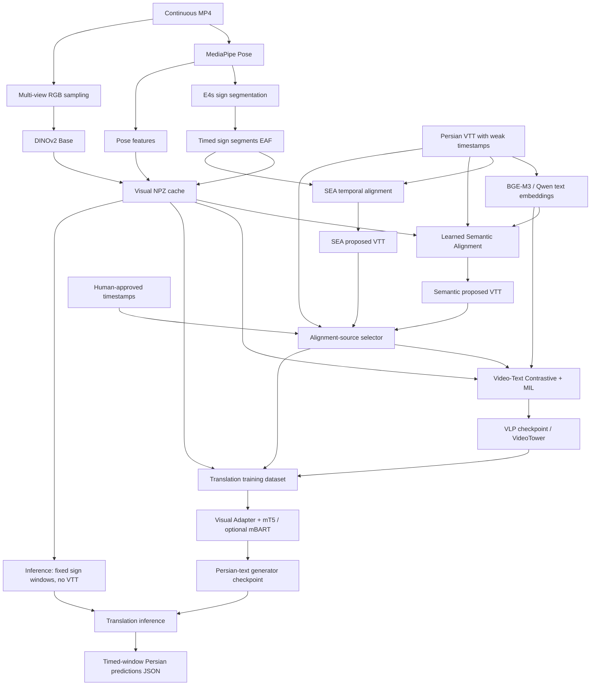

# Persian Sign Language → Persian Text | research_sign

> **مستند معماری، جریان داده و وضعیت پیاده‌سازی پروژه**  
> مخزن: [Aihan-2005/research_sign](https://github.com/Aihan-2005/research_sign)  
> مسیر اصلی پروژه: `Lab_project/sea_starter/`  
> مبنای مستندسازی: شاخه `main`، کامیت `4f782efb781e193b4e7bbaf18809d2f29db3d5bd` (۲۶ اکتبر ۲۰۲۶).  
> این مستند وضعیت **کد بررسی‌شده** را توضیح می‌دهد؛ وجود یک ماژول به معنی آموزش موفق یا صحت خروجی آن روی دیتاست واقعی نیست.

## فهرست مطالب

1. [هدف پروژه و تعریف مسئله](#goal)
2. [نقشهٔ معماری کل سیستم](#architecture)
3. [مراحل پردازش و معماری هر بخش](#stages)
4. [تفاوت انواع Alignment و اتصال Stageها](#alignment)
5. [مدل‌های بصری و ابعاد Tensorها](#models)
6. [خروجی هر مرحله و ساختار پوشه‌ها](#outputs)
7. [نصب، تست و دستورات اجرا](#usage)
8. [ارزیابی و اصول جلوگیری از Data Leakage](#evaluation)
9. [وضعیت فعلی و محدودیت‌ها](#status)
10. [برنامهٔ آزمایش‌های پژوهشی](#experiments)
11. [واژه‌نامه، مستندات و منابع کد](#glossary)

---

<a id="goal"></a>

## ۱. هدف پروژه و تعریف مسئله

هدف نهایی، دریافت **ویدیوی پیوستهٔ زبان اشارهٔ فارسی/ایرانی** و تولید **متن فارسی بدون نیاز به زیرنویس یا Gloss در زمان استفاده (Inference)** است:

```text
Continuous Sign Video (.mp4)
        ↓
Sign/Pose/Visual Representation
        ↓
Temporal Understanding + Persian Decoder
        ↓
Generated Persian Text
```

دادهٔ آموزشی فعلی، ویدیوهای پیوسته به‌همراه فایل‌های `.vtt` / `.srt` فارسی با **زمان‌بندی تقریبی** هستند، نه لزوماً کلیپ‌های دقیقاً برش‌خورده در مرز جمله. بنابراین دو مسئله را باید جدا حل کنیم:

- **Where?** کدام بازهٔ زمانیِ ویدیو با هر جملهٔ موجود در زیرنویس مرتبط است؟ (Alignment)
- **What?** از حرکت‌ها و نشانه‌های ویدیویی چه جمله‌ای باید تولید شود؟ (Translation)

زیرنویس در آموزش، هم متنِ هدف را فراهم می‌کند و هم سرنخ زمانی تقریبی می‌دهد؛ اما در Inference نهایی نباید ورودی مدل ترجمه باشد. **Gloss** نیز به‌عنوان ورودی/خروجی میانیِ اجباریِ مسیر ترجمه طراحی نشده است. البته لازم است منشأ داده‌های آموزشی مدل‌های آماده (مثل E4s) در گزارش پژوهشی جداگانه مستند شود.

### راهبرد پروژه

به‌جای استفاده از یک شبکهٔ غیرقابل‌توضیح، چند Stage قابل بررسی داریم: استخراج ویژگی، Segmentation، Alignment زمانی، Alignment معنایی، یادگیری نمایش مشترک Video–Text و در نهایت Decoder فارسی. چنین تفکیکی کمک می‌کند منشأ خطا را بین داده، مرزبندی، ویژگی بصری، تطبیق معنایی و تولید زبان شناسایی کنیم.

---

<a id="architecture"></a>

## ۲. نقشهٔ معماری کل سیستم

### ۲.۱. مسیرهای واقعی پیاده‌سازی‌شده



**دقت در خواندن نمودار:** SEA، Semantic Alignment، VLP و Translation همگی لزوماً در یک زنجیرهٔ اجباریِ متوالی اجرا نمی‌شوند. اکنون `pair_source` انتخاب می‌کند زمان‌های آموزشی از `raw`، `sea`، `semantic` یا `approved` تأمین شوند. تا وقتی Training با یک Source مشخص اجرا نشود، صرف داشتن فایل SEA به معنی استفادهٔ شبکهٔ ترجمه از آن نیست.

### ۲.۲. دو نوع خروجی اصلی

| خانوادهٔ مسیر | پرسش | خروجی |
|---|---|---|
| Temporal / Semantic Alignment | «متن موجود به کدام زمان ویدیو تعلق دارد؟» | VTT پیشنهادی و گزارش؛ یا مدل Alignment |
| Video–Text VLP | «ویژگی بصری و معنای متن چگونه به هم نزدیک شوند؟» | Checkpoint نمایش بصری/متنی، Retrieval metrics |
| Video-to-Persian Translation | «این حرکت‌ها چه جمله‌ای را بیان می‌کنند؟» | Checkpoint تولید زبان و متن تولیدشده |

---

<a id="stages"></a>

## ۳. مراحل پردازش و معماری هر بخش

### Stage A — آماده‌سازی داده و بررسی اولیه (Data Audit / Preflight)

**ورودی:** MP4، زیرنویس، شناسه‌های ویدیو، در صورت وجود Metadata مربوط به Signer/Recording.  
**وظیفه:** بررسی وجود فایل‌ها، زمان‌ها، شکل داده‌ها، سازگاری Cacheها، و جلوگیری از آمیختگی داده‌های Train/Validation/Test.  
**خروجی:** گزارش خطا و هشدار (JSON/متن)، نه مدل آموزش‌دیده.  
**کد:** [`features/preflight.py`](src/persian_sea/features/preflight.py)، [`cli/preflight.py`](src/persian_sea/cli/preflight.py)، [`scripts/pretrain_gate.py`](scripts/pretrain_gate.py)، [`video_text/split_audit.py`](src/persian_sea/video_text/split_audit.py).

قانون مهم: یک ویدیوی اصلی یا نسخهٔ بریده‌شدهٔ همان Recording نباید در دو Split متفاوت ظاهر شود. وقتی ممکن است، Splitها از نظر Signer و Session نیز جدا شوند. پایلوت یک‌ویدیویی صرفاً برای Smoke Test مناسب است، نه ارزیابی علمی Generalization.

### Stage B — Pose Extraction با MediaPipe

**ورودی:** فریم‌های ویدیو.  
**وظیفه:** ثبت موقعیت و Confidence نقاط بدن، دست‌ها و نشانه‌های مورد استفادهٔ پروژه. دادهٔ Pose به استخراج نشانه‌های حرکتی کمک می‌کند و به رنگ لباس/پس‌زمینه کمتر متکی است.  
**خروجی:** فایل `.pose` در `data/poses/` که بعداً برای هر Segment نمونه‌برداری و نرمال‌سازی می‌شود.  
**کد:** [`cli/pose.py`](src/persian_sea/cli/pose.py)، [`features/pose_reader.py`](src/persian_sea/features/pose_reader.py).

شکل Tensor نمونه‌برداری‌شده در Cache فعلی برای هر Segment: `[K=8, J=75, C=4]`؛ کانال‌ها مختصات/Confidence مدل‌اند. نکته: تعداد ۷۵ مربوط به **چینش نقاطی است که Encoder این پروژه مصرف می‌کند**؛ به معنی وجود دقیقاً ۷۵ نقطه در تمام خروجی خام MediaPipe نیست.

### Stage C — Sign Segmentation با E4s

**ورودی:** Pose و مدل Segmentation مربوط به E4s.  
**وظیفه:** پیشنهاد مرزهای زمانی قطعه‌های اشاره و ساخت دنبالهٔ مرتب از Segmentها، هرکدام با `start/end`.  
**خروجی:** فایل EAF در مسیری مانند `outputs/segmentation/E4s-1_30_50/<video_id>.eaf`.  
**کد:** [`segmentation/runner.py`](src/persian_sea/segmentation/runner.py)، [`segmentation/legacy_e4s.py`](src/persian_sea/segmentation/legacy_e4s.py)، [`segmentation/validator.py`](src/persian_sea/segmentation/validator.py).

**تفاوت بسیار مهم:** Segment در اینجا الزاماً یک «واژه»، یک Gloss صحیح یا یک «جمله» نیست. خطای Segmentation می‌تواند به همهٔ مراحل بعد منتقل شود. با Ground Truth مرزها می‌توان Precision/Recall/IoU یا Boundary Tolerance را مستقل ارزیابی کرد.

### Stage D — استخراج ویژگی RGB چندنما با DINOv2

**ورودی:** MP4، اطلاعات Segmentهای E4s و Pose برای تعیین Cropها.  
**وظیفه:** برای هر Segment چند Frame و چهار View را نمونه‌برداری می‌کند: `signer`، `left_hand`، `right_hand`، `face`. DINOv2 Base تصویر Cropشده را به Featureهای عددی تبدیل می‌کند.  
**خروجی:** `outputs/features/<video_id>.npz` شامل `pose`، `rgb`، `starts`، `ends` و اطلاعات مربوط به Viewها.  
**کد:** [`features/scanner.py`](src/persian_sea/features/scanner.py)، [`features/dinov2.py`](src/persian_sea/features/dinov2.py)، [`features/crops.py`](src/persian_sea/features/crops.py).

در Config فعلی: ۸ Frame در هر Segment × چهار View، با بردار RGB به طول ۷۶۸. پس هر Segment عموماً ورودی‌های `[8,75,4]` برای Pose و `[8,4,768]` برای RGB دارد. Featureها به‌صورت Cache محاسبه می‌شوند تا Trainingهای بعدی ناچار نباشند DINOv2 را در هر Epoch دوباره اجرا کنند. **DINOv2 در این Pipeline یک استخراج‌کنندهٔ Feature ازپیش‌آموزش‌دیده است؛ Fine-tune آن در Train اصلی از روی Cache اتفاق نمی‌افتد.**

### Stage E — Text Encoding با BGE-M3 / Qwen3-Embedding

**ورودی:** متن فارسی هر Cue از فایل VTT.  
**وظیفه:** تبدیل متن به Embedding مناسب برای مقایسهٔ معنایی با Feature ویدیو.  
**خروجی:** `outputs/text_features/bge_m3/<video_id>.npz` و فایل JSON هویت مدل/Cache.  
**کد:** [`text/bge_m3.py`](src/persian_sea/text/bge_m3.py)، [`text/qwen3_embedding.py`](src/persian_sea/text/qwen3_embedding.py)، [`text/cache.py`](src/persian_sea/text/cache.py).

BGE-M3 در پیاده‌سازی فعلی از نمایش Dense و نرمال‌شدهٔ ۱۰۲۴بعدی متن استفاده می‌کند؛ متن در مرحلهٔ استخراج Encode و Cache می‌شود و خود BGE-M3 در Train اصلی Freeze است. `TextTower`/Text Projectorهای آموزش‌پذیر این بردار را با فضای بصری هماهنگ می‌کنند. **BGE-M3 تولیدکنندهٔ متن فارسی نیست**؛ تولید جمله بر عهدهٔ mT5 یا mBART در Stage ترجمه است.

### Stage F — SEA Temporal Alignment: هماهنگی زمانی زیرنویس با Segmentها

**SEA در پروژهٔ فعلی چه کار می‌کند؟**

- **ورودی:** زمان‌های خام زیرنویس و زمان‌های Segmentهای E4s.
- **مکانیزم:** Dynamic Programming با قید ترتیب، نزدیکی آغاز/پایان، طول بازه و فاصلهٔ Segmentها؛ سپس Quality Gate برای کنترل جابه‌جایی‌های پیشنهادی.
- **خروجی:** `outputs/aligned_subtitles/<id>.proposed.vtt`، `<id>.review.json` و `<id>.vtt`.
- **کد:** [`alignment/dp.py`](src/persian_sea/alignment/dp.py)، [`alignment/backends.py`](src/persian_sea/alignment/backends.py)، [`alignment/pipeline.py`](src/persian_sea/alignment/pipeline.py)، [`alignment/quality_gate.py`](src/persian_sea/alignment/quality_gate.py).

SEA فعلی **معنی جمله را بررسی نمی‌کند**. در `alignment/pipeline.py`، `similarity_weight=0.0` تعیین شده و `sim_matrix` معنایی به DP داده نمی‌شود؛ بنابراین نسخهٔ اجرایی `sea_temporal` یک **Baseline زمان‌محور** است، نه SEA-S یا «SEA معنایی» کامل. این محدودیت آگاهانه ارزش علمی دارد، چون یک مرجع ساده برای مقایسه ایجاد می‌کند.

`proposed.vtt` زمان‌های پیشنهادی الگوریتم را نگه می‌دارد؛ در مقابل، `<id>.vtt` پس از Quality Gate ممکن است به علت محافظه‌کارانه‌بودن تنظیمات همچنان بخشی یا تمام زمان‌های خام را حفظ کند. برای Ablation منبع `sea`، فایل **`proposed.vtt`** به‌صورت صریح مصرف می‌شود. پیشنهاد SEA **Ground Truth انسانی محسوب نمی‌شود**.

### Stage G — Semantic Alignment: یافتن بازه با کمک معنای جمله

**ورودی:** Candidateهای زمانی نزدیک به هر Cue، RGB/Pose Cache و Embedding متن.  
**وظیفه:** `SemanticAligner` برای Candidate Spanهای مختلف نمایش بصری می‌سازد و شباهت آن‌ها را با بردار متن می‌سنجد؛ Temporal Prior نیز Candidateهای خیلی دور از زمان اولیه را جریمه می‌کند. هنگام انتخاب نتیجه برای همهٔ جمله‌ها، Global Monotonic Decoder ترتیب زمانی را کنترل می‌کند.  
**آموزش:** Contrastive/MIL با امکان Supervised Span Loss برای برچسب‌های **تأییدشدهٔ انسانی**.  
**خروجی:** Checkpoint از نوع `semantic_aligner.pt` و سپس `outputs/aligned_subtitles/semantic/<id>.proposed.vtt`، VTT و گزارش Review.  
**کد:** [`semantic/model.py`](src/persian_sea/semantic/model.py)، [`semantic/dataset.py`](src/persian_sea/semantic/dataset.py)، [`semantic/train.py`](src/persian_sea/semantic/train.py)، [`semantic/infer.py`](src/persian_sea/semantic/infer.py)، [`semantic/global_decode.py`](src/persian_sea/semantic/global_decode.py).

تفاوت با SEA: SEA Temporal فقط از **زمان** استفاده می‌کند؛ Semantic Alignment از **ویژگی بصری + متن + زمان تقریبی** استفاده می‌کند و برای رسیدن به نتیجهٔ معنایی نیازمند Training و Checkpoint معتبر است. خروجی آن باز هم **زمان‌بندی زیرنویس موجود** است، نه جملهٔ جدید.

### Stage H — Video–Text Representation Learning (VLP / Contrastive + MIL)

**ورودی:** Visual Cache، Text Cache، متن خام Cue و یک منبع زمان‌بندی انتخابی.  
**وظیفه:** یادگیری فضایی که یک بازهٔ ویدیویی و جملهٔ مرتبط در آن به هم نزدیک باشند. برای هر Cue به‌کمک زمان انتخابی Candidate Window ساخته می‌شود؛ `SpanPooler` بازه‌های ۱، ۲، ۴ و ۸ Segmentی می‌سازد. MIL شباهت متن را با مجموعهٔ Spanهای یک Video Bag ترکیب می‌کند؛ Contrastive Loss نمونهٔ درست را در مقایسه با Videoهای مستقل تقویت می‌کند.  
**خروجی:** `outputs/video_text/pretrain_first/best_video_text.pt`، گزارش‌های Loss و Retrieval `R@1` / `R@5`.  
**کد:** [`video_text/model.py`](src/persian_sea/video_text/model.py)، [`video_text/span_pooling.py`](src/persian_sea/video_text/span_pooling.py)، [`video_text/losses.py`](src/persian_sea/video_text/losses.py)، [`video_text/train.py`](src/persian_sea/video_text/train.py).

در Baseline فعلی، BGE-M3 بردار متن ۱۰۲۴بعدی می‌دهد؛ `TextTower` آن را به ۲۵۶ بعد می‌برد. VideoTower نیز Temporal Tokenهای ۲۵۶بعدی می‌سازد. `mean` و `attentive` برای Span Pooling وجود دارند و `pose_only`، `pose_rgb` و `pose_rgb_motion` به‌عنوان Visual Backend ثبت شده‌اند.

> **مهم:** `R@1 = 0.65` (اگر روزی گزارش شود) یعنی عملکرد Retrieval در همان ارزیابی؛ **نه** «ترجمهٔ ۶۵درصدیِ درست». Checkpoint این مرحله Sentence Generator نیست. برای Translation، بخش `model.video` یا همان **VideoTower** منتقل می‌شود؛ BGE-M3، TextTower، MIL و SpanPooler به‌عنوان مسیر تولید واژه به Decoder منتقل نمی‌شوند.

**تعداد ویدیو:** کد `video_text/train.py` دست‌کم `batch_size` ویدیوی متمایز در Train و دست‌کم **دو ویدیوی متمایز در Validation** می‌خواهد. Config `video_text_pretrain_first.yaml` مقدار `batch_size: 2` دارد؛ این حداقل فنی است و برای نتیجهٔ علمی کافی نیست. همان ویدیو را نباید به‌صورت مصنوعی تکثیر کرد و به‌عنوان Negative مستقل شمرد.

### Stage I — GFSLT-VLP-inspired Persian Translation (mT5 / mBART)

**ورودی Training:** زوجِ Visual Window و متن فارسی همان Cue؛ VisualTower از Checkpoint مرحلهٔ VLP بارگذاری می‌شود.  
**معماری:** `VideoTower [B,M,256] → VisualLanguageAdapter → mT5`؛ گزینهٔ آزمایشی `mBART-50` با هدف فارسی `fa_IR` نیز پیاده شده است. Adapter ابعاد حافظهٔ بصری را با Hidden Dimension مدل زبانی سازگار می‌کند و Decoder با Cross-Attention به حافظهٔ بصری کلمات فارسی را به‌ترتیب پیش‌بینی می‌کند.  
**Loss:** Cross-Entropy توکن‌های هدف با Teacher Forcing و Mask کردن Padding در Labelها (`-100`).  
**خروجی Training:** `best_translation.pt`، `last_translation.pt`، `history.jsonl`، Tokenizer و `readiness.json`.  
**کد:** [`translation/model.py`](src/persian_sea/translation/model.py)، [`translation/data.py`](src/persian_sea/translation/data.py)، [`translation/train.py`](src/persian_sea/translation/train.py)، [`translation/language.py`](src/persian_sea/translation/language.py).

کد فعلی با `BaseModelOutput(last_hidden_state=...)`، خروجی Adapter را مستقیماً به‌عنوان `encoder_outputs` به Seq2Seq Decoder می‌دهد. بنابراین Encoder متنی داخلی mT5/mBART در این مسیر **روی Video Tokens جداگانه اجرا نمی‌شود**. این اتصال به یک Visual Encoder خارجی، طراحی مشخص معماری ماست، نه پیاده‌سازی خط‌به‌خط GFSLT-VLP اصلی.

در Baseline اولیه `freeze_visual: true` است: VideoTower منجمد می‌ماند و Adapter و مدل زبانی آموزش می‌بینند. از ایدهٔ **دو مرحله‌ایِ Visual–Language Pretraining → Translation** در GFSLT-VLP استفاده شده، ولی **Masked Sentence Reconstruction و پیش‌آموزش مشترک Decoder در مرحلهٔ VLP اصلی** در این کد وجود ندارد؛ بنابراین باید این معماری را **GFSLT-VLP-inspired** توصیف کرد، نه Reproduction دقیق مقاله.

### Stage J — Inference: تولید متن بدون زیرنویس

**ورودی فعلی فرمان `infer`:** `outputs/features/<video_id>.npz` و Checkpoint ترجمه. ورودی مستقیم این تابع MP4 نیست؛ باید پیش‌پردازش و استخراج Visual Cache قبلاً انجام شده باشد.  
**وظیفه:** تقسیم دنبالهٔ Segmentها به پنجره‌های زمانی مستقل از VTT، اجرای VideoTower + Adapter + Decoder و ساخت متن فارسی برای هر پنجره.  
**خروجی:** `outputs/translation/<run>/predictions/<video_id>.json` حاوی `start`، `end`، `text` و تعداد Segmentهای هر پنجره.  
**کد:** [`translation/infer.py`](src/persian_sea/translation/infer.py)، [`translation/data.py`](src/persian_sea/translation/data.py).

Config فعلی `max_source_segments: 32` و `inference_stride_segments: 32` دارد. این پنجره‌ها **مرز جمله نیستند**: یک پنجره ممکن است شامل نصف دو جمله یا چند جمله باشد. این **Train–Inference Mismatch** محدودیت اصلی نسخهٔ فعلی برای ویدیوی پیوسته است؛ کد مسیر تولید متن را فراهم می‌کند اما هنوز کیفیت ترجمهٔ بدون VTT و مرزبندی جمله‌ها روی دادهٔ واقعی اثبات نشده است.

---

<a id="alignment"></a>

## ۴. تفاوت انواع Alignment و اتصال Stageها

### ۴.۱. یک مثال فرضی

```text
Subtitle: «فردا باران می‌بارد»
Raw VTT: 10.0s — 14.0s
E4s segments: S1, S2, S3, ...

SEA Temporal: کدام گروه از Sها از نظر زمان و ترتیب مناسب‌تر است؟
Semantic Alignment: کدام Span از نظر Visual/Text similarity مناسب‌تر است؟
Video–Text VLP: چطور Encoder یاد بگیرد Span درست را نسبت به موارد منفی ترجیح دهد؟
Translation: از نمایش حرکت، چه توکن‌های فارسی باید تولید شوند؟
```

این‌ها چهار وظیفهٔ متفاوت‌اند؛ **اصلاح زمان‌بندی مساوی با یادگیری معنی و مساوی با تولید متن نیست**.

### ۴.۲. انتخاب منبع زمان‌بندی در Training

فایل مرکزی: [`alignment_sources.py`](src/persian_sea/alignment_sources.py). چهار مقدار `pair_source`:

| Source | فایلِ انتخاب زمان | کاربرد | احتیاط |
|---|---|---|---|
| `raw` | `data/subtitles_raw/<id>.vtt` | Baseline با زمان خام | زمان ممکن است نویزی باشد |
| `sea` | `outputs/aligned_subtitles/<id>.proposed.vtt` | Ablation اثر SEA Temporal | زمان پیشنهادی، نه GT |
| `semantic` | `outputs/aligned_subtitles/semantic/<id>.proposed.vtt` | Ablation اثر Semantic Alignment | ابتدا Checkpoint معنایی و خروجی معتبر لازم است |
| `approved` | `data/subtitles_approved/<id>.vtt` | آموزش با زمان‌های بازبینی‌شده | صرفاً فایلِ واقعاً تأییدشده، نه کپی خام |

مدول Selector متن، ترتیب جمله‌ها و تعداد Cueها را با زیرنویس خام تطبیق می‌دهد؛ فقط زمان انتخابی تغییر می‌کند. در صورت نبودن فایل یا ناهماهنگی متن/ترتیب، **به Raw به‌صورت مخفیانه برنمی‌گردد**. این قابلیت در Datasetهای VLP و Translation وجود دارد؛ پس می‌توان اثر Source را با ثابت نگه‌داشتن Model بررسی کرد.

### ۴.۳. ارتباط با Oracle Coverage

[`diagnostics/oracle_coverage.py`](src/persian_sea/diagnostics/oracle_coverage.py) با **زمان مرجعِ مستقل و تأییدشدهٔ انسانی** می‌سنجد که بهترین Candidate موجود چه IoUای با بازهٔ صحیح دارد. اگر Oracle Coverage پایین باشد، احتمالاً باید Candidate Window، Span Sizes یا Segmentation را بررسی کرد؛ صرف تعویض Text Encoder مشکل نبودن Candidate درست را حل نمی‌کند. این دادهٔ مرجع برای **ارزیابی** است و نباید Test GT را برای تنظیم Hyperparameterها مصرف کرد.

---

<a id="models"></a>

## ۵. مدل‌های بصری و ابعاد Tensorها

### ۵.۱. Backendهای فعلی و نقش هرکدام

| ماژول / معماری | وظیفه | فایل |
|---|---|---|
| `PoseSemanticEncoder` | Graph Convolution بر نقاط بدن/دست + Temporal Transformer + Pooling | [`model/pose_encoder.py`](src/persian_sea/model/pose_encoder.py) |
| `CachedRGBEncoder` | Project ویژگی‌های DINOv2، Attention بر Viewها و Temporal Transformer | [`model/rgb_encoder.py`](src/persian_sea/model/rgb_encoder.py) |
| `GatedPoseRGBFusion` | ادغام یادگرفتنی بردار Pose و RGB با Gate | [`model/fusion.py`](src/persian_sea/model/fusion.py) |
| `PoseDeltaEncoder` | ویژگی اختلاف حرکت بین نمونه‌های متوالی Pose | [`model/motion_encoder.py`](src/persian_sea/model/motion_encoder.py) |
| `VideoTower` | ساخت Token برای هر Sign Segment، افزودن زمان نسبی/مدت/فاصله و Context زمانی | [`video_text/model.py`](src/persian_sea/video_text/model.py) |
| `SpanPooler` | تبدیل دنبالهٔ Video Tokens به Candidate Span Embeddings برای Retrieval/MIL | [`video_text/span_pooling.py`](src/persian_sea/video_text/span_pooling.py) |
| `VisualLanguageAdapter` | Projection نمایش ویدیو به Hidden Space مولد زبان | [`translation/model.py`](src/persian_sea/translation/model.py) |

Registry فعلی در [`model/builders.py`](src/persian_sea/model/builders.py):

- `pose_only` — فقط Pose؛ برای سنجش سهم RGB مفید است.
- `pose_rgb` — Pose + RGB و Gated Fusion؛ Baseline اصلی.
- `pose_rgb_motion` — اضافه‌کردن اطلاعات دلتا/حرکت Pose؛ Ablation موجود.

**توجه:** ST-GCN، ASGCN، SOKE/VQ-VAE، TwoStream عمیق و Neural Sign Actors در Registry فعلی به‌عنوان Backend قابل انتخاب پیاده‌سازی نشده‌اند؛ آن‌ها ایده‌های آزمایشی آینده‌اند. شباهت ایدهٔ فعلی به مقاله‌ها نباید با پیاده‌سازی عین آن‌ها اشتباه گرفته شود.

### ۵.۲. مثال Shape برای یک Batch

`B` تعداد نمونه‌های Batch، `M` تعداد **Sign Segmentهای انتخاب‌شده برای یک Cue یا Window**، `K=8` تعداد نمونهٔ زمانی هر Segment، `V=4` تعداد Viewها است:

```text
Pose tensor:  [B, M, 8, 75, 4]
RGB tensor:   [B, M, 8,  4, 768]
VideoTower:   [B, M, 256]   (VLP/Translation default)
Text BGE-M3:  [B, 1024]
TextTower:    [B, 256]
SpanPooler:   [B, S, 256]  (S depends on 1/2/4/8 segment spans)
```

در Semantic Alignment مقدار پیش‌فرض فضای Embedding طبق `configs/baseline.yaml`، **۵۱۲** است؛ در VLP اولیه مقدار **۲۵۶** است. این دو Stage و دو Config را نباید در توصیف ابعاد با هم مخلوط کرد. `M` نیز الزاماً تعداد ۶۲۷ Segment کل ویدیو نیست؛ در آموزش به‌وسیلهٔ Candidate Selection محدود می‌شود.

---

<a id="outputs"></a>

## ۶. خروجی هر مرحله و ساختار پوشه‌ها

### ۶.۱. مهم‌ترین ورودی‌ها و خروجی‌ها

| Stage | ورودی اصلی | خروجی نمونه |
|---|---|---|
| Pose | MP4 | `data/poses/news001.pose` |
| E4s Segmentation | Pose / مدل E4s | `outputs/segmentation/E4s-1_30_50/news001.eaf` |
| Visual Extraction | MP4 + Pose + EAF | `outputs/features/news001.npz` |
| Text Extraction | VTT فارسی | `outputs/text_features/bge_m3/news001.npz` و JSON |
| SEA Temporal | Raw VTT + EAF | `outputs/aligned_subtitles/news001.proposed.vtt` و Review |
| Semantic Alignment | Video/Text Cache + مدل | `outputs/aligned_subtitles/semantic/news001.proposed.vtt` |
| VLP Train | Visual/Text Cache + Split | `outputs/video_text/pretrain_first/best_video_text.pt` |
| Translation Train | VLP Checkpoint + Visual Cache + متن هدف | `outputs/translation/mt5_first/best_translation.pt` |
| Translation Infer | Visual Cache + Translation Checkpoint | `outputs/translation/mt5_first/predictions/news001.json` |

این‌ها **مسیرهای نمونه یا خروجی مورد انتظار کد** هستند؛ وجودشان روی رایانهٔ محلی یا کامل‌شدن آموزش را تضمین نمی‌کنند. مسیر خروجی هر آزمایش از Config مربوط به همان آزمایش تبعیت می‌کند.


### ۷.۶. Oracle Coverage فقط با GT واقعی

```bash
persian-sea-oracle-coverage \
  --config configs/baseline.yaml \
  --video-text-config configs/video_text_pretrain_first.yaml \
  --mode both --ids data/val_ids.txt \
  --require-complete-gt \
  --report outputs/reports/val_oracle.json
```

قبل از اجرای این فرمان باید `data/subtitles_gt/` دارای VTTهای **مستقل و تأییدشدهٔ انسانی** باشد. بدون آن، جایگزین‌کردن VTT خام یا خروجی SEA به‌جای GT باعث ارزیابی گمراه‌کننده می‌شود.

---

<a id="evaluation"></a>

## ۸. ارزیابی و اصول جلوگیری از Data Leakage

| مرحله | معیار مناسب | چه چیزی را اندازه نمی‌گیرد؟ |
|---|---|---|
| E4s | Segment IoU، Boundary Tolerance، Precision/Recall در صورت GT | معنی یا درستی جمله |
| SEA / Semantic Alignment | Boundary MAE، IoU، Oracle Coverage با GT مستقل | کیفیت متن تولیدشده |
| Video–Text VLP | Retrieval Loss، R@1، R@5 | BLEU یا Accuracy ترجمه |
| Translation (Cue-level) | Validation Loss، BLEU، chrF و بررسی انسانی | کیفیت واقعی پنجره‌بندی بدون VTT |
| Continuous Inference | بررسی متن‌های تولیدشده در ویدیوهای Test بدون VTT ورودی، و معیارهای متناسب با مرزبندی | با Cue-level VTT-guided Eval یکسان نیست |

اصول اصلی:

1. جداسازی Train/Val/Test را بر مبنای **ویدیوی اصلی و Source Recording** انجام دهید؛ ترجیحاً Signer جدا باشد.
2. از Test GT برای انتخاب Hyperparameterها، تنظیم Window یا انتخاب مدل استفاده نکنید.
3. خروجی `SEA proposed` یا `Semantic proposed` را هرگز به‌عنوان حقیقت قطعی اعلام نکنید؛ آن‌ها **پیش‌بینی** هستند.
4. هنگام مقایسهٔ `raw` و `sea`، مدل، Seed، Split، بودجهٔ آموزش، Cacheها و Decoder را ثابت نگه دارید.
5. دقت کنید BLEU/chrF فعلی از **پنجره‌هایی استفاده می‌کند که هنگام Evaluation با VTT انتخاب شده‌اند**؛ پس معادل ترجمهٔ ویدیوی آزاد با مرزبندی کشف‌شده نیست.
6. SHA/Revision مدل‌های آماده و Metadata Cacheها را ذخیره کنید؛ تغییر Backbone یا Text Backend می‌تواند Cache و Checkpoint را ناسازگار کند.

---

<a id="status"></a>

## ۹. وضعیت فعلی و محدودیت‌ها

### ۹.۱. آخرین نتیجهٔ پایلوت گزارش‌شده در گفت‌وگو

طبق لاگ‌هایی که از اجرای `news001` روی مک ارسال شده‌اند:

| مورد | وضعیت گزارش‌شده |
|---|---|
| Pose | ساخته شد؛ حدود ۵۲٫۹ MiB |
| E4s | ۶۲۷ Segment، Tier با نام `SIGN` |
| BGE-M3 | Cache متنی `news001.npz` ساخته شد |
| Subtitle | ۲۸ Cue؛ مدت ویدیو حدود ۱۹۷٫۰۸۸ ثانیه |
| `pilot_workflow.py check` | `RESULT: PASS | 0 errors` |
| SEA Temporal | `news001.proposed.vtt` و `news001.review.json` ساخته شدند |
| Bundle | `news001_inputs.zip` در دستگاه کاربر، حدود ۷۴ MiB |
| استخراج کامل DINOv2 برای همهٔ Segmentها | در آخرین لاگ تأیید نشده |
| آموزش واقعی VLP / Semantic / Translation با دیتاست مستقل | در آخرین لاگ تأیید نشده |

**این اعداد صرفاً وضعیت گزارش‌شدهٔ همان پایلوت‌اند، نه نتیجهٔ اندازه‌گیری جدید من و نه ادعای دقت زبانی.** یک PASS در Preflight نمی‌گوید که Alignment یا ترجمه درست است.

### ۹.۲. محدودیت‌های مهم نسخهٔ فعلی

- `SEA temporal` هنوز Similarity معنایی را به DP وارد نمی‌کند؛ این Baseline فقط زمان‌محور است.
- `semantic` و `sea` حالا Sourceهای قابل انتخاب Training هستند، اما برای استفاده از آن‌ها باید **خروجی هر ویدیوی Split** تولید شده باشد.
- روی دیتاست پیوسته، Timestampهای VTT در زمان ساخت زوج آموزشی استفاده می‌شوند؛ کیفیت آن‌ها باید با بازبینی انسانی آزموده شود.
- GFSLT-VLP اصلی با Masked Language Restoration و انتقال Decoder پیش‌آموزش‌دیده تفاوت دارد؛ کد حاضر یک معماری **inspired** است.
- در اجرای ترجمهٔ فعلی، mT5/mBART متن فارسی را می‌سازد و BGE در مسیر Generate استفاده نمی‌شود.
- Inference به Visual Cache وابسته است، نه MP4 مستقیم؛ پنجره‌های ثابت جای Sentence Boundary Detection را نگرفته‌اند.
- Token-level Video–Text Optimal Transport (VTaMo)، PGG-SLT/CTC شبه‌Gloss، ST-GCN/ASGCN، VQ-VAE، SEA-S کامل و Decoder pretraining به سبک کامل GFSLT هنوز **پیاده‌سازی اصلی فعال** نیستند.
- یک ویدیوی نمونه برای تست وجود مسیر کد مناسب است، نه برای نتیجه‌گیری دربارهٔ قابلیت تعمیم به Signer یا موضوع جدید.

---

<a id="experiments"></a>

## ۱۰. برنامهٔ آزمایش‌های پژوهشی

پیشنهادِ ترتیب آزمایش با حفظ قابلیت مقایسهٔ علمی:

| اولویت | آزمایش | پرسش علمی |
|---|---|---|
| ۰ | Feature/Cache Audit + بازبینی نمونهٔ Pose/E4s/VTT | آیا دادهٔ ورودی قابل اعتماد است؟ |
| ۱ | Oracle Coverage و مقایسهٔ Raw / SEA / Semantic با GT انسانی | آیا Candidate صحیح در Windowها پیدا می‌شود؟ |
| ۲ | Baseline با `BGE-M3 + pose_rgb + mean + raw` | آیا Representation مشترک قابل یادگیری است؟ |
| ۳ | تغییر فقط `pair_source=sea`؛ سپس `semantic` یا `approved` | Alignment بهتر چقدر به Retrieval/Translation کمک می‌کند؟ |
| ۴ | تغییر فقط `span_pooling=attentive` و Backend Motion/Pose | آیا نحوهٔ تجمیع/ویژگی حرکت بهبود می‌دهد؟ |
| ۵ | Translation Baseline `mT5` و مقایسهٔ اختیاری با `mBART-50` | کدام Decoder روی فارسی و سخت‌افزار ما بهتر است؟ |
| ۶ | اندازه‌گیری و سپس رفع Train–Inference Window Mismatch | آیا مرزهای جمله در ویدیوی آزاد درست پیدا می‌شوند؟ |
| ۷ | Ablation Freeze/Partial Fine-tuning و Positional Encoding داخل Segment | کدام بخش یادگیری واقعاً سود دارد؟ |
| ۸ | اختیاری: SEA-S، VTaMo Local OT، GFSLT Masked Pretraining | آیا Alignment ریزدانه یا Pretraining اضافی بهبود می‌دهد؟ |
| ۹ | فقط با دادهٔ معتبر: PGG-SLT؛ سپس ST-GCN/ASGCN/VQ | آیا Supervision یا Encoder پیچیده‌تر ارزش افزوده دارد؟ |

**mBART Text Encoder** به‌عنوان جایگزین BGE-M3، و **VTaMo / PGG-SLT** در حال حاضر تنها پیشنهاد آزمایش‌اند؛ کد فعلی از نظر اجرای اصلی، فقط `BGE-M3/Qwen3` را برای Text Embedding و `mT5/mBART-50` را برای Translation پشتیبانی می‌کند. بین «داشتن Config»، «پیاده‌سازی ماژول» و «گذراندن Training واقعی» تفاوت وجود دارد.

---

<a id="glossary"></a>

## ۱۱. واژه‌نامه، مستندات و منابع کد

| اصطلاح | معنی در این پروژه |
|---|---|
| `Cue` | یک جمله/بخش متن همراه با بازهٔ زمان زیرنویس |
| `Sign Segment` | قطعهٔ زمانی پیشنهادی Segmentation؛ الزاماً یک کلمه یا جمله نیست |
| `Pose` | مختصات و Confidence نقاط بدن/دست‌ها |
| `Visual Cache` | Tensorهای ازپیش‌محاسبه‌شدهٔ Pose/RGB و زمان‌ها در NPZ |
| `SEA` | Alignment زمانی مبتنی بر E4s و Dynamic Programming در Baseline فعلی |
| `Semantic Alignment` | پیش‌بینی بازهٔ ویدیو با ترکیب Visual/Text Similarity و قیود زمانی |
| `MIL` | Multiple Instance Learning برای یادگیری از Bag کاندیداهای زمانی بدون مرز دقیق |
| `Contrastive` | نزدیک‌کردن زوج‌های Video/Text مرتبط و دورکردن موارد منفی معتبر |
| `VLP` | Visual–Language Pretraining؛ در این پروژه Representation Learning با MIL/Contrastive |
| `Decoder` | شبکهٔ تولید توکن‌های متن فارسی به‌صورت ترتیبی |
| `Oracle IoU` | بیشترین تطابق **ممکن** Candidateها با Ground Truth مستقل |
| `Ablation` | مقایسهٔ کنترل‌شده با تغییر یک جزء و ثابت‌نگه‌داشتن سایر عوامل |
| `Gloss` | برچسب نمادین/زبانیِ نشانه؛ ورودی اجباری مسیر ترجمهٔ فعلی نیست |

### فایل‌های مرجع پروژه

- [تنظیمات پایه](configs/baseline.yaml)، [تنظیمات پایلوت مک](configs/pilot_mac.yaml)
- [SEA Temporal Pipeline](src/persian_sea/alignment/pipeline.py)، [SEA Dynamic Programming](src/persian_sea/alignment/dp.py)
- [Semantic Aligner](src/persian_sea/semantic/model.py)، [Semantic Inference](src/persian_sea/semantic/infer.py)
- [VLP VideoTower و TextTower](src/persian_sea/video_text/model.py)، [VLP Training](src/persian_sea/video_text/train.py)
- [Alignment Source Selector](src/persian_sea/alignment_sources.py)
- [Translation Model](src/persian_sea/translation/model.py)، [Translation Train](src/persian_sea/translation/train.py)، [Translation Inference](src/persian_sea/translation/infer.py)
- [Translation Config: mT5](configs/translation_mt5_first.yaml)، [Translation Config: mBART optional](configs/translation_mbart50_optional.yaml)
- [Oracle Coverage](src/persian_sea/diagnostics/oracle_coverage.py)

### نحوهٔ استفاده از این README

این فایل برای قرارگرفتن در `Lab_project/sea_starter/README.md` تهیه شده است. برای افزودن به GitHub، فایل را به همان مسیر انتقال دهید، تست‌های لازم را اجرا کنید، سپس تغییر مستند را Commit/Push کنید. README به‌تنهایی مدل‌ها یا Pipeline را اجرا و اصلاح نمی‌کند و فایل‌های داده/Checkpoint را نیز با خودش به مخزن منتقل نمی‌کند.

---

**یک جمله برای معرفی پروژه:**  
«ما یک Pipeline ماژولار برای ترجمهٔ بدون Gloss از ویدیوی پیوستهٔ زبان اشاره به متن فارسی طراحی کرده‌ایم که Segmentation، Alignment زمانی SEA، Alignment معنایی، یادگیری مشترک Video–Text و Decoder مولد زبان را از هم تفکیک می‌کند تا هم آموزش و هم تحلیل خطا و Ablationها قابل بازتولید باشند.»
