# Persian Sign Language to Persian Text

## مستند معماری، جریان داده، فرآیند یادگیری و استنتاج

> **نوع پروژه:** Research Prototype برای ترجمهٔ بدون Gloss از ویدیوی
> پیوستهٔ زبان اشارهٔ ایرانی به متن فارسی\
> **مخزن:** https://github.com/Aihan-2005/research_sign\
> **مسیر:** `Lab_project/sea_starter/`\
> **Snapshot مبنا:** شاخهٔ `main`، Commit
> `1a8fe31ce728faf9625e93a5e6e3304a844f038c`\
> این مستند معماری کد موجود را توضیح می‌دهد؛ ادعای Training کامل روی کل
> دیتاست یا عملکرد نهایی مدل نیست.

------------------------------------------------------------------------

## فهرست مطالب

1.  هدف و تعریف مسئله
2.  نمای کلی معماری
3.  داده‌ها و قرارداد Tensorها
4.  استخراج Pose، Sign Segment و RGB
5.  Visual Encoder
6.  نمایش متنی فارسی
7.  Subtitle Alignment
8.  Video--Text Representation Learning
9.  Sentence Boundary Detection و SignShift-inspired Head
10. Persian Sign Language Translation
11. Inference از ویدیوی پیوسته
12. ساختار پوشه‌ها
13. Training، Evaluation و اجرای پروژه
14. محدودیت‌های فعلی
15. نقشهٔ راه پژوهشی

------------------------------------------------------------------------

# 1. هدف و تعریف مسئله

هدف پروژه ساخت یک سامانهٔ **Gloss-Free Sign Language Translation (SLT)**
است که ویدیوی پیوستهٔ زبان اشارهٔ ایرانی را دریافت کند و متن فارسی متناظر
با محتوای اشاره را تولید کند.

مسئله دو وظیفهٔ متمایز دارد:

  -----------------------------------------------------------------------
  وظیفه                   سؤال                    خروجی
  ----------------------- ----------------------- -----------------------
  Subtitle Alignment      هر Cue متنی به کدام     Timestamp پیشنهادی
                          بازهٔ ویدیو تعلق دارد؟   

  Sign Language           حرکات زبان اشاره چه     متن فارسی تولیدشده
  Translation             جمله‌ای را بیان می‌کنند؟  
  -----------------------------------------------------------------------

اصلاح زمان زیرنویس به‌معنی یادگیری ترجمه نیست. همچنین Retrieval موفق
Video--Text به‌تنهایی اثبات نمی‌کند که مدل می‌تواند جملهٔ فارسی صحیح تولید
کند.

در Training از Subtitle به‌عنوان متن هدف و گاهی به‌عنوان منبع زمان تقریبی
استفاده می‌شود. در مسیر نهایی Inference، مدل نباید VTT، متن مرجع یا Gloss
دریافت کند.

# 2. نمای کلی معماری

## 2.1. معماری کل پروژه

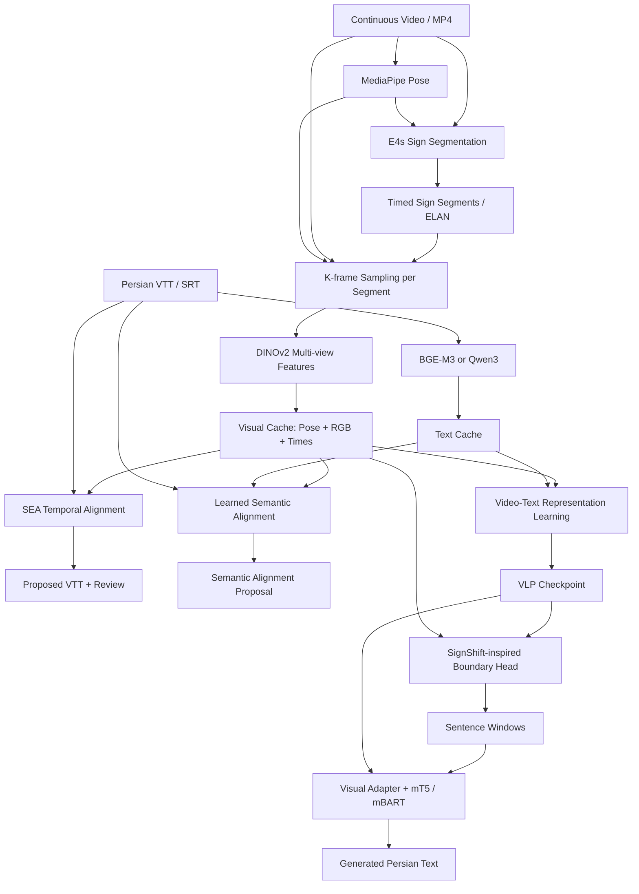

این نمودار همهٔ ماژول‌های موجود را نشان می‌دهد؛ اما تمام شاخه‌ها الزاماً در
هر آزمایش پشت سر هم اجرا نمی‌شوند.

## 2.2. سه خانوادهٔ اصلی مدل

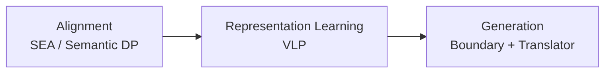

-   **Alignment:** زمان Subtitle موجود را با زمان Sign Segmentها تطبیق
    می‌دهد.
-   **VLP:** نمایش مشترک ویدیو و متن را یاد می‌گیرد.
-   **Generation:** مرز جمله را پیش‌بینی می‌کند و متن فارسی تولید می‌کند.

# 3. داده‌ها و قرارداد Tensorها

هر ویدیو ابتدا توسط E4s به N عدد Sign Segment تقسیم می‌شود. برای هر
Segment تعداد K نمونهٔ زمانی استخراج می‌شود.

مقادیر پیش‌فرض فعلی:

```yaml
scanner:
  samples_per_segment: 8
  views: [signer, left_hand, right_hand, face]
```

-   N: تعداد Sign Segmentها
-   K: تعداد نمونه‌های زمانی داخل هر Segment؛ در Config فعلی ۸
-   J: تعداد Landmarkهای Pose؛ برابر ۷۵
-   V: تعداد Viewهای RGB؛ در تنظیم فعلی ۴
-   D_rgb: بعد DINOv2 Base؛ برابر ۷۶۸

## 3.1. نمونه‌برداری زمانی

K نمونه، فریم‌های متوالی نیستند. برای هر Segment با بازهٔ `[start, end]`،
بازه به K قسمت تقسیم می‌شود و مرکز هر قسمت به‌عنوان زمان نمونه انتخاب
می‌شود.

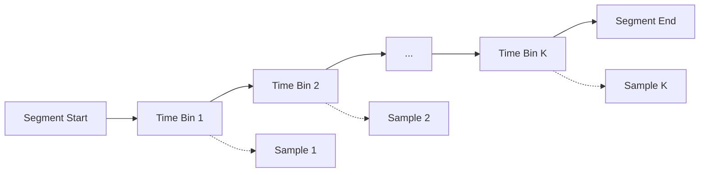

## 3.2. Visual Cache

  آرایه              Shape           توضیح
  ------------------ --------------- --------------------------------
  `pose`             `[N,K,75,4]`    مختصات و Confidence نقاط Pose
  `rgb`              `[N,K,4,768]`   Featureهای چهار View از DINOv2
  `sample_times`     `[N,K]`         زمان واقعی نمونه‌ها
  `pose_indices`     `[N,K]`         اندیس فریم در Pose
  `video_indices`    `[N,K]`         اندیس فریم در ویدیو
  `starts`, `ends`   `[N]`           زمان شروع و پایان Sign Segment
  `views`            `[4]`           ترتیب Viewها

مثال برای ۵۷۶ Segment و K=8:

```text
Pose: [576, 8, 75, 4]
RGB : [576, 8, 4, 768]
```

محل ذخیره: `outputs/features/<video_id>.npz`

# 4. استخراج Pose، Sign Segment و RGB

## 4.1. Pose Extraction

ویدیو با MediaPipe پردازش می‌شود و Pose در فایل زیر ذخیره می‌شود:

```text
data/poses/<video_id>.pose
```

تنظیمات اصلی در بخش `pose` فایل YAML قرار دارند؛ از جمله
`model_complexity`، `smooth_landmarks` و `refine_face_landmarks`.

## 4.2. E4s Sign Segmentation

Pose استخراج‌شده به E4s داده می‌شود تا Sign Segmentهای اولیه ساخته شوند.

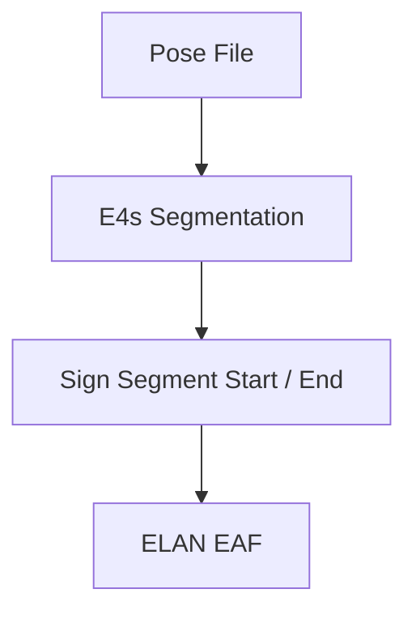

خروجی معمول:

```text
outputs/segmentation/<model_thresholds>/<video_id>.eaf
```

Sign Segment الزاماً واژه، Gloss یا جمله نیست؛ E4s قطعه‌بندی اولیه را
انجام می‌دهد، نه تشخیص نهایی مرز جمله.

## 4.3. RGB Multi-view Feature Extraction

برای هر زمان نمونه‌برداری‌شده، Cropهای زیر ساخته می‌شوند:

-   `signer`: نمای Signer
-   `left_hand`: دست چپ
-   `right_hand`: دست راست
-   `face`: صورت

Cropها وارد DINOv2 Base می‌شوند و Featureهای ۷۶۸بعدی ذخیره می‌شوند.

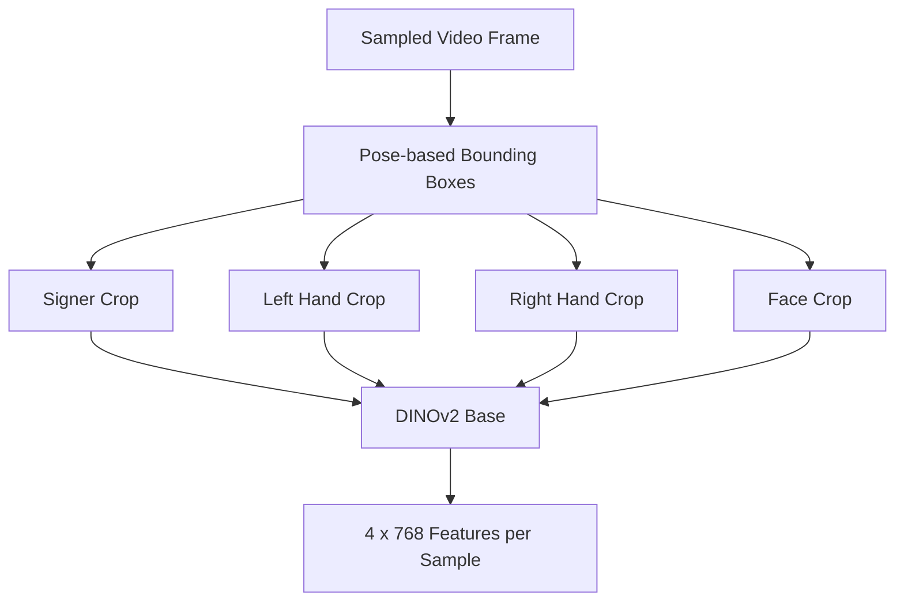

DINOv2 در مسیر فعلی Feature Extractor ثابت است؛ Featureهای آن در
Preprocessing Cache می‌شوند و وزن‌های DINOv2 در Training اصلی تغییر
نمی‌کنند.

فایل‌های مرتبط: - `features/scanner.py` - `features/sampling.py` -
`features/crops.py` - `features/dinov2.py` - `pose/runner.py` -
`segmentation/runner.py`

# 5. Visual Encoder

Visual Encoder اصلی دو شاخه دارد: Pose و RGB. خروجی دو شاخه با Gated
Fusion ترکیب می‌شود.

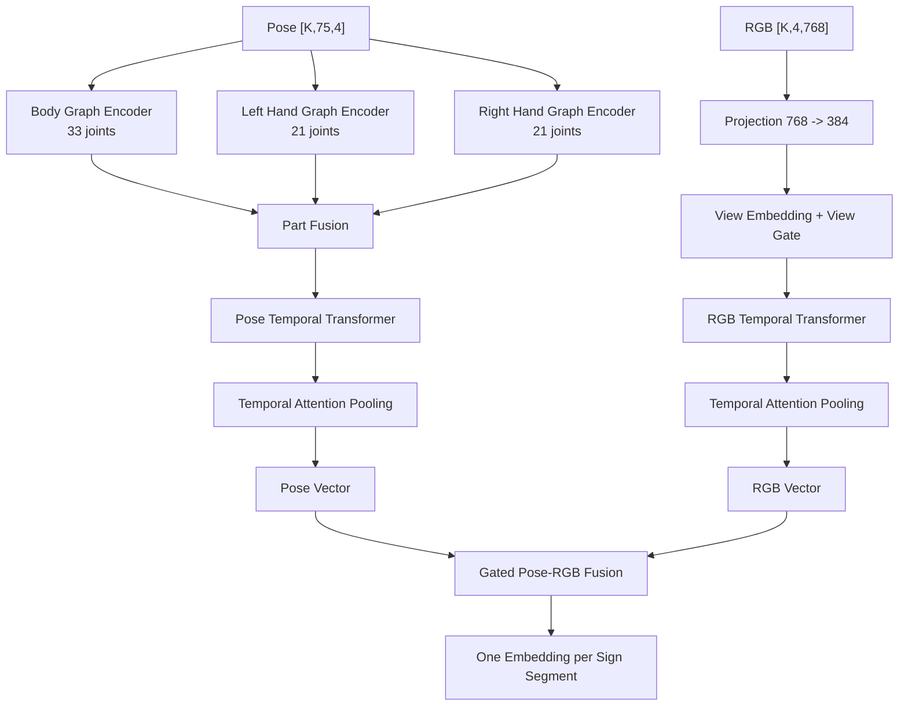

## 5.1. Pose Encoder

ورودی Pose برابر `[B,K,75,4]` است. ۷۵ نقطه شامل ۳۳ نقطهٔ بدن و ۲۱ نقطه
برای هر دست است.

هر قسمت توسط Graph Encoder پردازش می‌شود. نمایش Body و دو دست ادغام
می‌شوند، سپس Temporal Transformer ترتیب K نمونه را بررسی می‌کند. Attention
Pooling در نهایت یک بردار برای هر Sign Segment می‌سازد.

وزن‌های Graph Encoder دو دست مشترک‌اند؛ یعنی دست چپ و راست دو Graph
Encoder مستقل با وزن‌های جدا ندارند.

فایل: `model/pose_encoder.py`

## 5.2. RGB Encoder

ورودی `[B,K,4,768]` است. ابتدا DINO Featureها به بعد ۳۸۴ Projection
می‌شوند. Embedding نوع View اضافه می‌شود و View Gate چهار View را در هر
زمان ترکیب می‌کند. سپس Temporal Transformer روی K نمونه اجرا می‌شود و
Attention Pooling یک بردار Segment می‌سازد.

**چهار View در RGB Encoder چهار Temporal Stream مستقل تا انتها نیستند؛
ابتدا در هر زمان با View Gate ترکیب می‌شوند و سپس توالی زمانی وارد
Transformer می‌شود.**

فایل: `model/rgb_encoder.py`

## 5.3. Gated Fusion

اگر `p` نمایش Pose و `r` نمایش RGB باشد:

\[ g=`\sigma`{=tex}(W_g\[p;r\]),`\qquad`{=tex}
z=g`\odot `{=tex}r+(1-g)`\odot `{=tex}p \]

پس از Fusion، Projection و Normalization انجام می‌شود.

بعد خروجی وابسته به Config است؛ در VLP فعلی معمولاً ۲۵۶ و در Semantic
Aligner معمولاً ۵۱۲ است.

فایل: `model/fusion.py`

## 5.4. Motion Encoder

Backend آزمایشی `pose_rgb_motion` از PoseDeltaEncoder استفاده می‌کند.
اختلاف نمونه‌های زمانی مجاور برای Body، Left Hand و Right Hand محاسبه
می‌شود. ویژگی‌های Signed Delta، Absolute Delta و RMS Delta وارد Conv1D
می‌شوند و از طریق Gate با نمایش اصلی ترکیب می‌شوند.

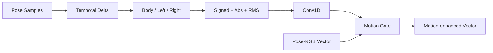

Backendهای ثبت‌شده در `model/builders.py`: `pose_only`، `pose_rgb`،
`pose_rgb_motion`، `rgb_only`، `pose_rgb_positional` و
`pose_rgb_cross_attention`.

# 6. نمایش متنی فارسی

دو Text Backend اصلی وجود دارند:

-   `bge_m3`: مدل `BAAI/bge-m3`
-   `qwen3_embedding`: مدل `Qwen/Qwen3-Embedding-0.6B`

## 6.1. BGE-M3

در مسیر فعلی، Sentence Embedding با Hidden State اولین Token (CLS-style
pooling) ساخته و Normalize می‌شود. بعد آن ۱۰۲۴ است.

همچنین Word Embedding قابل استخراج است: با Fast Tokenizer و
`offset_mapping`، Subwordهای هر کلمه پیدا می‌شوند، میانگین گرفته می‌شوند و
Normalize می‌شوند.

Cache کلمات شامل این موارد است:

-   `word_embeddings`
-   `word_cue_offsets`
-   `word_texts`
-   `word_char_offsets`

## 6.2. Qwen3

در Qwen3، آخرین Token معتبر با توجه به Attention Mask انتخاب و Normalize
می‌شود. این Backend در مسیر فعلی Sentence Embedding تولید می‌کند.

## 6.3. آیا Word Embedding در VLP فعال است؟

BGE-M3 می‌تواند Sentence و Word Embedding را در Cache ذخیره کند؛ اما
`VideoTextDataset` و `VideoTextModel` فعلی در مسیر اصلی VLP از Sentence
Embedding استفاده می‌کنند. بنابراین وجود Word Embedding در NPZ به معنی
فعال بودن Word-level VLP Loss نیست.

در Translation، OTA از Tokenهای Text Encoder مدل mT5/mBART استفاده
می‌کند؛ این Tokenها با Word Embeddingهای BGE یکی نیستند.

فایل‌ها: `text/bge_m3.py`، `text/qwen3_embedding.py`، `text/cache.py`،
`text/cache_identity.py`.

# 7. Subtitle Alignment

سه مسیر متمایز وجود دارد.

## 7.1. SEA Temporal

ورودی: Cueهای VTT و Sign Segmentهای E4s. الگوریتم Candidate Window را
انتخاب می‌کند و Dynamic Programming با هزینهٔ Duration و Gap، تخصیص ترتیبی
Cueها به گروه‌های Sign Segment را پیدا می‌کند.

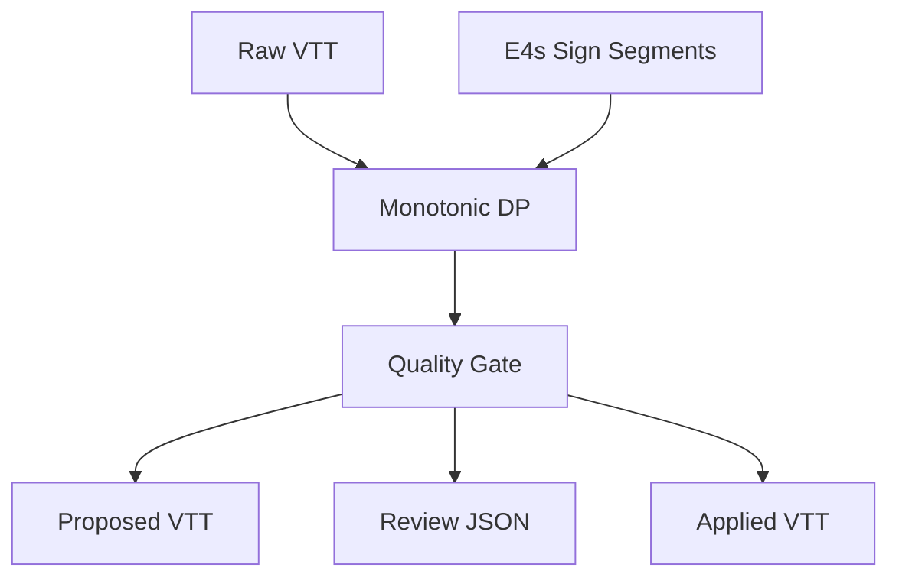

خروجی‌ها: - `*.proposed.vtt`: پیشنهاد الگوریتم - `*.review.json`: تصمیم
Quality Gate - `*.vtt`: زمان‌های اعمال‌شده؛ ممکن است زمان اصلی حفظ شده
باشد.

محدودیت: `alignment/pipeline.py` ماتریس Semantic Similarity نمی‌سازد. اگر
`similarity_weight` غیرصفر باشد، Pipeline خطا می‌دهد. بنابراین
`sea_temporal` در وضعیت فعلی Baseline زمان‌محور است.

## 7.2. Learned Semantic Alignment

در `semantic/` یک Semantic Aligner آموزش‌پذیر وجود دارد:

1.  Candidate Segmentهای اطراف زمان تقریبی Cue انتخاب می‌شوند.
2.  Visual Encoder، Pose و RGB را به Segment Embedding تبدیل می‌کند.
3.  Candidate Context Encoder با ویژگی‌های Relative Midpoint، Duration و
    Gap، توالی را Contextualize می‌کند.
4.  Spanهای متوالی با محدودیت تعداد Segment و Duration ساخته می‌شوند.
5.  Semantic Similarity متن و Span با Temporal/Duration Prior ترکیب
    می‌شود.
6.  Contrastive Bag Loss و در صورت وجود GT مستقل، Supervised Span Loss
    محاسبه می‌شود.
7.  در Inference، Candidateها رتبه‌بندی و با Global Monotonic Decoder
    انتخاب می‌شوند.

\[ S\_{`\text{final}`{=tex}} =
S\_{`\text{semantic}`{=tex}}+`\lambda`{=tex}*t S*{`\text{timing}`{=tex}}
\]

فایل‌ها: `semantic/model.py`، `semantic/dataset.py`، `semantic/train.py`،
`semantic/infer.py`.

## 7.3. VLP-based Semantic DP

اسکریپت `scripts/align_sea_semantic_vlp.py` مسیر جداگانه‌ای است. با VLP
Checkpoint ماتریس Similarity بین Cueها و Sign Segmentها ساخته می‌شود و
Semantic DP می‌تواند بعضی Sign Segmentها را Skip کند یا برای بعضی Cueها
Null Alignment انتخاب کند.

این مسیر با Learned Semantic Aligner در `semantic/` یکی نیست.

## 7.4. انتخاب منبع زمان آموزشی

پارامتر `pair_source` در Configهای VLP، Boundary و Translation می‌تواند
یکی از این مقادیر باشد:

  مقدار        منبع
  ------------ ---------------------------------------
  `raw`        `data/subtitles_raw/`
  `approved`   `data/subtitles_approved/`
  `sea`        `outputs/aligned_subtitles/`
  `semantic`   `outputs/aligned_subtitles/semantic/`

فایل‌های SEA و Semantic در حالت‌های مربوطه به‌صورت `proposed.vtt` انتخاب
می‌شوند. تعداد Cue، متن و ترتیب باید با Raw یکسان بماند. Alignment
پیشنهادی الگوریتم به‌خودی‌خود Ground Truth انسانی نیست.

# 8. Video--Text Representation Learning (VLP)

VLP نمایش مشترکی از ویدیو و متن فارسی یاد می‌گیرد. خروجی اصلی آن Visual
Encoder آموزش‌دیده است؛ VLP مستقیماً جملهٔ فارسی تولید نمی‌کند.

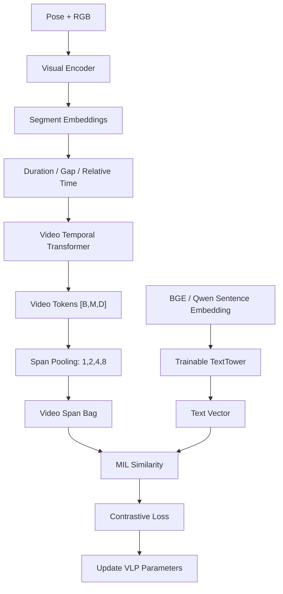

## 8.1. VideoTower

برای هر Sign Segment یک Visual Embedding ساخته می‌شود. سپس Relative
Midpoint، Log Duration و Log Gap به آن اضافه می‌شوند و توالی وارد
Temporal Transformer می‌شود.

خروجی نمونه: `[B,M,256]`.

## 8.2. TextTower

Sentence Embedding متنی به فضای مشترک Projection می‌شود. برای BGE-M3،
ورودی ۱۰۲۴بعدی و خروجی Config فعلی معمولاً ۲۵۶بعدی است.

## 8.3. Multi-scale Span Pooling

Config معمول:

```yaml
span_sizes: [1, 2, 4, 8]
span_pooling: mean
```

Spanهای متوالی با طول‌های مختلف ساخته می‌شوند. روش Pooling می‌تواند `mean`
یا `attentive` باشد.

## 8.4. MIL و Contrastive Learning

برای هر متن چند Candidate Span بصری وجود دارد. MIL شباهت متن با مجموعهٔ
Spanهای یک ویدیو را با LogSumExp نرمال‌شده ترکیب می‌کند. سپس Contrastive
Loss زوج‌های مرتبط را نزدیک و زوج‌های نامرتبط را دور می‌کند.

برای جلوگیری از Negative اشتباه، نمونه‌های متعلق به یک ویدیو و متن‌های
نرمال‌شدهٔ یکسان Mask می‌شوند. Batch باید به تعداد کافی ویدیوی مستقل داشته
باشد.

### چه چیزهایی یاد گرفته می‌شوند؟

-   Visual Encoder
-   Video Temporal Transformer
-   TextTower
-   Span Pooler در حالت Attentive

### چه چیزهایی ثابت‌اند؟

-   DINOv2 که قبلاً Feature Cache را ساخته است.
-   BGE-M3 یا Qwen3 که قبلاً Text Cache را ساخته‌اند.

Checkpoint نمونه:

```text
outputs/video_text/pretrain_first/best_video_text.pt
```

معیارهای VLP شامل Retrieval Loss و R@1/R@5 هستند؛ این معیارها کیفیت
Retrieval را می‌سنجند، نه کیفیت تولید ترجمه.

فایل‌ها: `video_text/model.py`، `dataset.py`، `span_pooling.py`،
`losses.py`، `train.py`.

# 9. Sentence Boundary Detection و SignShift-inspired Head

این ماژول توالی Sign Segmentها را می‌گیرد و برای هر Segment احتمال شروع و
پایان جمله را پیش‌بینی می‌کند. این پیاده‌سازی از ایده‌های SignShift الهام
گرفته است و نباید Reproduction کامل مقالهٔ SignShift معرفی شود.

## 9.1. ورودی و Streamها

برای N Sign Segment، VLP Visual Encoder ویژگی سراسری می‌سازد:

```text
features: [N,D]
starts  : [N]
ends    : [N]
```

در حالت Multi-stream، سه Stream محلی ساخته می‌شود:

-   `signer`: میانگین Featureهای DINO مربوط به Signer در K نمونه
-   `hands`: میانگین دو View دست چپ و راست و سپس میانگین روی K نمونه
-   `face`: میانگین Featureهای Face در K نمونه

**در Boundary Head فعلی، Left Hand و Right Hand دو Stream مستقل نیستند؛
در `hands` ادغام می‌شوند.**

## 9.2. معماری Boundary Head

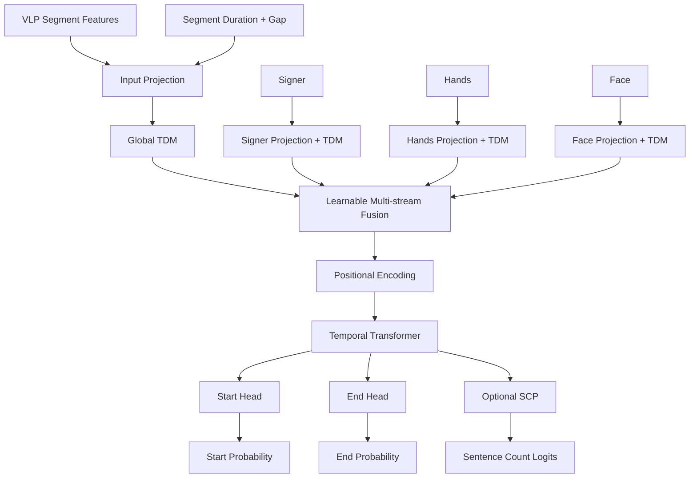

## 9.3. TDM

Config فعلی:

```yaml
use_tdm: true
tdm_offsets: [1, 2, 4, 8]
```

Offsetها فاصله بر حسب **Sign Segment** هستند، نه فریم و نه نمونه‌های داخل
یک Segment.

\[ `\Delta`{=tex}*d(t)=x_t-x*{t-d} \]

Global TDM و TDMهای Streamهای محلی تغییرات چندمقیاسی را مدل می‌کنند.

## 9.4. SCP

در صورت فعال بودن `use_scp`، یک Segment Count Head مبتنی بر Dilated
Conv1D و Attention Pooling تعداد احتمالی جمله‌ها را پیش‌بینی می‌کند.

وقتی SCP فعال است، `decode_count_constrained` تعداد جمله‌ها را با
Start/End Probability ترکیب می‌کند و Partition کامل می‌سازد؛ در نتیجه همهٔ
Sign Segmentها تخصیص داده می‌شوند.

وقتی SCP خاموش است، Event Decoder می‌تواند بعضی Segmentها را خارج از
پنجره‌های جمله باقی بگذارد.

## 9.5. Label و Loss

Label شروع و پایان از نزدیک‌ترین مرکز Sign Segment به Timestamp شروع و
پایان Cue ساخته می‌شود. بنابراین Label فعلی Weak Supervision است.

\[ L=L\_{`\text{BCE}`{=tex}}+
`\lambda`{=tex}*sL*{`\text{smooth}`{=tex}}+
`\lambda`{=tex}*cL*{`\text{SCP}`{=tex}} \]

-   BCE: Start/End Classification
-   Smoothness: کاهش نوسان شدید احتمال در Segmentهای مجاور
-   SCP: تطبیق توزیع Count با تعداد Cueهای آموزشی

تعداد Cueهای Subtitle الزاماً تعداد جمله‌های واقعی زبان اشاره نیست.

## 9.6. معیارها

کد از Start/End Precision، Recall و F1، Macro Boundary F1، Sentence
F1@10/25/50، SER و Count MAE پشتیبانی می‌کند.

برای گزارش علمی باید Validation/Test مستقل و مرزهای بازبینی‌شده در اختیار
باشد. معیارهایی که از Raw Subtitle ساخته می‌شوند باید `weak` نامیده شوند.

## 9.7. محدودیت Frame-level

Boundary Head فعلی روی Sign Segmentها کار می‌کند. K نمونهٔ داخل هر Segment
فقط برای استخراج Feature است. خروجی مرز در سطح اندیس Sign Segment قرار
دارد.

در نسخهٔ فعلی Frame-level Boundary Head، Dense Frame Refinement و پیش‌بینی
Timestamp در وسط یک Sign Segment پیاده‌سازی نشده‌اند.

فایل‌ها: `translation/boundary.py`، `translation/signshift.py`،
`scripts/train_sentence_boundaries.py`،
`scripts/predict_sentence_boundaries.py`.

# 10. Persian Sign Language Translation

مدل ترجمه، Visual Tokens را از VideoTower می‌گیرد و از طریق Adapter به
Decoder مدل زبانی می‌دهد.

مدل‌های قابل استفاده: - `google/mt5-small` - mBART-50 با Config سازگار

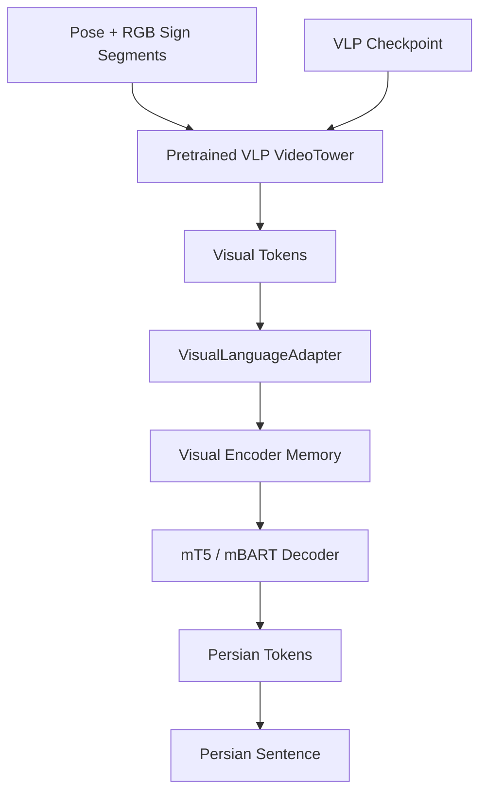

## 10.1. VisualLanguageAdapter

Adapter شامل LayerNorm، Linear، GELU، Dropout و Linear است. خروجی آن
به‌صورت `encoder_outputs` به مدل Seq2Seq داده می‌شود.

در این مسیر Visual Tokens حافظهٔ ورودی Decoder هستند؛ Encoder متنی داخلی
mT5 روی ویدیو اجرا نمی‌شود.

## 10.2. Training و Teacher Forcing

هر نمونه شامل Visual Window و متن فارسی Cue متناظر است. Timestamp Cue
برای انتخاب Candidate Segmentها و متن Cue برای Target استفاده می‌شود.

مدل با Teacher Forcing و Cross-Entropy آموزش می‌بیند:

\[
L\_{`\text{CE}`{=tex}}=-`\sum`{=tex}*t`\log `{=tex}P(y_t`\mid `{=tex}y*{\<t},V)
\]

در Config اولیه `freeze_visual: true` است؛ در نتیجه Visual Tower ثابت
می‌ماند و Adapter و Decoder آموزش می‌بینند.

## 10.3. Optional OTA

در Configهای DualAnchor/VTaMo-inspired، `ota_enabled` می‌تواند فعال شود.

Visual Tokens با Tokenهای متن که از Text Encoder مدل Seq2Seq استخراج
شده‌اند، با Partial Optimal Transport و Dustbin تطبیق داده می‌شوند.

\[ L=L\_{`\text{CE}`{=tex}}+
`\lambda`{=tex}*{`\text{OTA}`{=tex}}L*{`\text{OT}`{=tex}}+
`\lambda`{=tex}*{`\text{temp}`{=tex}}L*{`\text{temporal}`{=tex}} \]

این یک پیاده‌سازی الهام‌گرفته از ایده‌های OT است؛ نه ادعای بازتولید کامل یک
مقاله.

## 10.4. Optional TPA

در حالت `tpa_enabled` یک Teacher زبانی Freeze می‌شود. توزیع توکن Teacher
با Student از طریق KL Divergence مقایسه می‌شود و Loss کمکی به Training
اضافه می‌شود.

این مسیر یک Prior زبانی کمکی است؛ به معنی دریافت Subtitle در Inference
نیست.

Checkpointها در `outputs/translation/<run_name>/` ذخیره می‌شوند: -
`best_translation.pt` - `last_translation.pt` - `history.jsonl` -
`readiness.json` - `tokenizer/`

نکتهٔ اجرایی: `translation/train.py` در نسخهٔ فعلی برای Training واقعی
CUDA را الزامی می‌کند.

فایل‌ها: `translation/model.py`، `data.py`، `train.py`،
`ot_alignment.py`، `config.py`.

# 11. Inference از ویدیوی پیوسته

دو مسیر Inference وجود دارد.

## 11.1. Fixed-window Inference

`translation/infer.py::generate_video` Visual Cache را به پنجره‌های ثابت
تقسیم می‌کند؛ مثلاً ۳۲ Segment با Stride برابر ۳۲.

این مسیر VTT نمی‌خواند، اما پنجرهٔ ثابت الزاماً جمله نیست. ممکن است بخشی از
جمله یا چند جمله را شامل شود.

## 11.2. Continuous Inference

`translation/continuous.py::ContinuousInferenceEngine` دو Checkpoint
می‌گیرد:

1.  Boundary Checkpoint
2.  Translation Checkpoint

و VLP Checkpoint سازگار با آن‌ها را بارگذاری می‌کند.

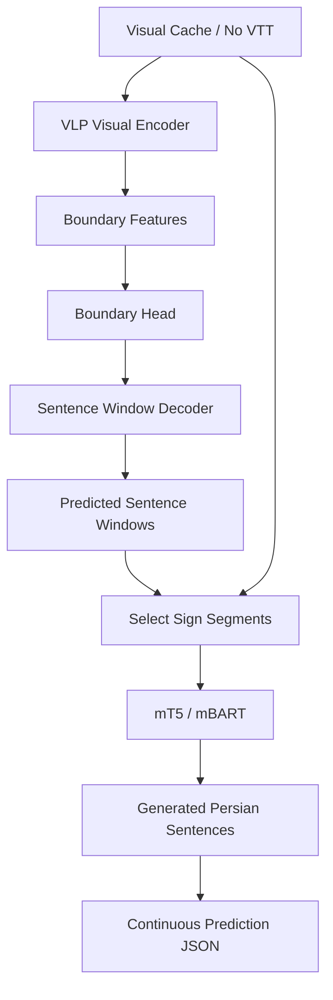

مراحل: 1. Visual Cache و زمان Segmentها خوانده می‌شوند. 2. VLP برای هر
Segment Feature می‌سازد. 3. Boundary Head احتمال Start و End را پیش‌بینی
می‌کند. 4. Decoder پنجره‌های جمله را می‌سازد. 5. Visual Window هر جمله به
Translator داده می‌شود. 6. متن فارسی تولید و در JSON ذخیره می‌شود.

این CLI با `--video-id` کار می‌کند؛ نه با MP4 خام. بنابراین Preprocessing
و ساخت Visual Cache باید از قبل انجام شده باشد.

نمونه:

```bash
python scripts/infer_continuous.py \
  --translation-config configs/translation_mt5_first.yaml \
  --translation-checkpoint outputs/translation/mt5_first/best_translation.pt \
  --boundary-checkpoint outputs/sentence_boundaries_signshift_phase3/best_sentence_boundary.pt \
  --video-id vid001
```

Continuous Engine سازگاری Hash مربوط به VLP Checkpoint و مسیر Visual
Cache را کنترل می‌کند.

# 12. ساختار پوشه‌ها

```text
sea_starter/
├── README.md
├── pyproject.toml
├── configs/
│   ├── smoke5_mac.yaml
│   ├── video_text_pretrain_first.yaml
│   ├── sentence_boundaries.yaml
│   ├── sentence_boundaries_phase2.yaml
│   ├── sentence_boundaries_signshift_phase3.yaml
│   ├── stage4_mean_bge.yaml
│   ├── stage4_attentive_bge.yaml
│   ├── stage4_motion_attentive_bge.yaml
│   ├── translation_mt5_first.yaml
│   └── translation_mt5_dualanchor_vtamo*.yaml
├── data/
│   ├── videos/
│   ├── poses/
│   ├── subtitles_raw/
│   ├── subtitles_gt/
│   ├── subtitles_approved/
│   ├── segmentation_gt/
│   ├── train_ids.txt
│   ├── val_ids.txt
│   └── test_ids.txt
├── outputs/
│   ├── segmentation/
│   ├── features/
│   ├── text_features/
│   ├── aligned_subtitles/
│   ├── boundary_features/
│   ├── sentence_boundaries/
│   ├── video_text/
│   ├── translation/
│   └── reports/
├── scripts/
│   ├── pilot_workflow.py
│   ├── train_sentence_boundaries.py
│   ├── predict_sentence_boundaries.py
│   ├── align_signshift.py
│   ├── align_sea_semantic_vlp.py
│   └── infer_continuous.py
├── src/persian_sea/
│   ├── alignment/
│   ├── cli/
│   ├── core/
│   ├── data/
│   ├── features/
│   ├── model/
│   ├── pose/
│   ├── segmentation/
│   ├── semantic/
│   ├── text/
│   ├── translation/
│   ├── video_text/
│   ├── config.py
│   └── types.py
└── tests/
```

مسئولیت پوشه‌ها:

  پوشه              مسئولیت
  ----------------- --------------------------------------------
  `features/`       Sampling، Crop، DINOv2 و Feature Cache
  `pose/`           استخراج Pose
  `segmentation/`   اجرای E4s و اعتبارسنجی
  `alignment/`      SEA DP، Semantic DP و Quality Gate
  `semantic/`       Learned Semantic Alignment
  `text/`           BGE، Qwen و Text Cache
  `model/`          Pose/RGB/Motion Encoder و Fusion
  `video_text/`     VLP، MIL و Contrastive Learning
  `translation/`    Boundary، SignShift-inspired و Translation
  `cli/`            فرمان‌های ماژولار
  `scripts/`        آزمایش‌ها و Workflowهای پژوهشی
  `tests/`          Unit و Integration Tests

این Tree نمای مسیرهای مهم است، نه فهرست تمام فایل‌های فرعی.

# 13. Training، Evaluation و اجرای پروژه

دستورات از پوشهٔ `Lab_project/sea_starter/` اجرا می‌شوند.

## 13.1. نصب

```bash
python3.11 -m venv .venv
source .venv/bin/activate
python -m pip install --upgrade pip
python -m pip install -e ".[dev]"
```

## 13.2. Preflight

```bash
python -m persian_sea.cli.preflight \
  --config configs/smoke5_mac.yaml \
  --video-ids data/smoke5_ids.txt \
  --check-pose --check-caches \
  --report outputs/reports/preflight.json
```

## 13.3. Preprocessing

```bash
python -m persian_sea.cli.preprocess \
  --config configs/smoke5_mac.yaml \
  --video-ids data/smoke5_ids.txt \
  --steps pose segment visual text
```

مراحل قابل انتخاب: `pose`، `segment`، `visual` و `text`.

## 13.4. Alignment

```bash
persian-sea-align --config configs/smoke5_mac.yaml
```

Semantic Training و Inference:

```bash
persian-sea-train-semantic --config configs/stage5_baseline_qwen.yaml

persian-sea-align-semantic \
  --config configs/stage5_baseline_qwen.yaml \
  --video-ids data/val_ids.txt
```

## 13.5. VLP Training

```bash
persian-sea-train-video-text \
  --config configs/video_text_pretrain_first.yaml
```

## 13.6. Boundary Training و Prediction

```bash
python scripts/train_sentence_boundaries.py \
  --config configs/sentence_boundaries_signshift_phase3.yaml

python scripts/predict_sentence_boundaries.py \
  --checkpoint outputs/sentence_boundaries_signshift_phase3/best_sentence_boundary.pt \
  --video-id vid001
```

## 13.7. Translation

```bash
python -m persian_sea.translation.cli check \
  --config configs/translation_mt5_first.yaml

python -m persian_sea.translation.cli train \
  --config configs/translation_mt5_first.yaml
```

Fixed-window inference:

```bash
python -m persian_sea.translation.cli infer \
  --config configs/translation_mt5_first.yaml \
  --checkpoint outputs/translation/mt5_first/best_translation.pt \
  --video-id vid001
```

Continuous inference:

```bash
python scripts/infer_continuous.py \
  --translation-config configs/translation_mt5_first.yaml \
  --translation-checkpoint outputs/translation/mt5_first/best_translation.pt \
  --boundary-checkpoint outputs/sentence_boundaries_signshift_phase3/best_sentence_boundary.pt \
  --video-id vid001
```

## 13.8. معیارهای ارزیابی

  وظیفه            معیار
  ---------------- -------------------------------------------
  E4s              Segment IoU و Boundary Tolerance
  Alignment        Boundary MAE، IoU و Candidate Coverage
  VLP              Retrieval Loss، R@1 و R@5
  Boundary         F1@10/25/50، SER و Count MAE
  Translation      Validation Loss، BLEU و chrF
  Continuous SLT   Transcript-level Metrics و ارزیابی انسانی

Splitهای Train، Validation و Test باید مستقل باشند. در صورت امکان،
Signer و Source Recording نیز بین Splitها جدا شوند.

Evaluation ترجمه‌ای که VTT از آن برای انتخاب پنجره استفاده می‌کند،
**Subtitle-free Continuous SLT Evaluation نیست**.

# 14. محدودیت‌های فعلی

  قابلیت                                 وضعیت فعلی
  -------------------------------------- ------------------------------------
  MediaPipe Pose                         پیاده‌سازی شده
  E4s Sign Segmentation                  یکپارچه شده
  DINOv2 چهار View                       پیاده‌سازی شده
  Pose Graph Encoder                     پیاده‌سازی شده
  RGB Temporal Encoder                   پیاده‌سازی شده
  Pose-RGB Gated Fusion                  پیاده‌سازی شده
  PoseDelta Motion                       Backend آزمایشی موجود
  BGE Sentence Embedding                 پیاده‌سازی شده
  BGE Word Embedding Cache               پیاده‌سازی شده
  Word-level BGE Loss در مسیر اصلی VLP   فعال نیست
  SEA Temporal DP                        پیاده‌سازی شده
  Learned Semantic Aligner               پیاده‌سازی شده
  VLP Contrastive + MIL                  پیاده‌سازی شده
  SignShift-inspired TDM                 پیاده‌سازی شده؛ در سطح Sign Segment
  Multi-stream Boundary                  سه Stream: Signer، Hands، Face
  SCP                                    پیاده‌سازی شده و اختیاری
  mT5 Translation                        پیاده‌سازی شده
  mBART-50                               Backend اختیاری
  Partial OT                             Loss اختیاری در Translation
  TPA                                    Loss اختیاری
  Continuous Inference                   مسیر Boundary + Translation موجود
  Frame-level Boundary Refinement        پیاده‌سازی نشده
  Dense Frame Transformer                پیاده‌سازی نشده

## 14.1. وضعیت SignShift و SEA Integration

در Snapshot مبنا: - `scripts/align_signshift.py` وجود دارد. -
`SignShiftBoundaryRuntime` وجود دارد. - اما
`alignment.pipeline.align_one` فقط امضای `align_one(video_id, cfg)` را
دارد. - Backend Registry فقط `original` و `sea_temporal` را ثبت کرده
است.

بنابراین اسکریپت `align_signshift.py` که آرگومان‌های `signshift_runtime`،
`backend_override` و `sea_signshift` را ارسال می‌کند با API فعلی سازگار
نیست. نباید اتصال کامل SignShift به SEA را در وضعیت فعلی ادعا کرد.

در مقابل، `ContinuousInferenceEngine` مسیر مستقلی برای استفاده از
Boundary Model و Translation Model دارد.

## 14.2. Weak Labels

مرزهای Boundary فعلی از نزدیک‌ترین مرکز Sign Segment به زمان شروع و پایان
Subtitle ساخته می‌شوند. تعداد Cueها نیز برای SCP به‌عنوان تقریب تعداد
جمله‌ها استفاده می‌شود.

پس بدون Annotation مستقل نمی‌توان عملکرد Sentence Boundary را به‌صورت قطعی
گزارش کرد.

## 14.3. Full Coverage

وقتی SCP فعال است، Decoder تمام Sign Segmentها را در Partition جمله‌ها
قرار می‌دهد. این فرض برای Transition یا حرکات غیرزبانی ممکن است مناسب
نباشد.

## 14.4. Frame-level Timing

Boundary Head فعلی مرز را در سطح E4 Sign Segment می‌دهد. اگر مرز واقعی
وسط یک Segment باشد، مدل فعلی Timestamp دقیق درون آن Segment را پیش‌بینی
نمی‌کند.

# 15. نقشهٔ راه پژوهشی

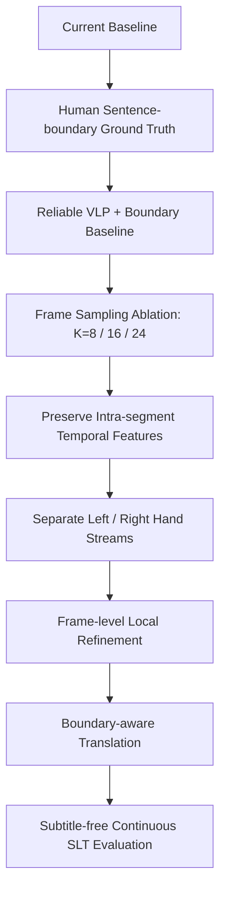

اولویت‌های پیشنهادی:

1.  ساخت Ground Truth انسانی برای مرز جمله‌ها و کنترل Splitها.
2.  تثبیت Baseline VLP و Boundary روی دادهٔ کافی.
3.  مقایسهٔ K برابر ۸، ۱۶ و ۲۴ با Cache و Training سازگار.
4.  بررسی Stream مستقل دست چپ و راست.
5.  توسعهٔ Frame-level Refinement اطراف مرزهای Coarse.
6.  اتصال Boundary دقیق‌تر به Translation و ارزیابی Continuous.

در Frame-level Refinement، ابتدا SignShift مرز تقریبی را پیدا می‌کند؛ سپس
پنجره‌ای از فریم‌های اطراف مرز با Pose Velocity، Hand Motion و RGB
Featureها بررسی می‌شود. این بخش هنوز توسعهٔ آینده است.

------------------------------------------------------------------------

## جمع‌بندی

معماری فعلی پروژه یک Research Prototype ماژولار برای ترجمهٔ بدون Gloss از
ویدیوی پیوستهٔ زبان اشارهٔ ایرانی به متن فارسی است.

ویدیو ابتدا با MediaPipe و E4s به Pose و Sign Segment تبدیل می‌شود.
DINOv2 برای چهار View تصویری Feature استخراج می‌کند. Visual Encoder،
اطلاعات Pose و RGB را به نمایش‌های Segment-level تبدیل می‌کند. VLP با MIL
و Contrastive Learning نمایش Video و Sentence Text را در فضای مشترک
آموزش می‌دهد. Boundary Detector الهام‌گرفته از SignShift مرز جمله‌ها را در
سطح Sign Segment پیش‌بینی می‌کند. سپس Visual Tokens از طریق Adapter به
Decoder مدل mT5 یا mBART داده می‌شوند تا متن فارسی تولید شود.

هدف نهایی، دریافت ویدیوی پیوسته و تولید Transcript فارسی بدون استفاده از
Subtitle یا Gloss در زمان Inference است. ادعای دقت نهایی باید پس از
Training واقعی، Annotation مستقل و Evaluation روی Test جداگانه مطرح شود.
